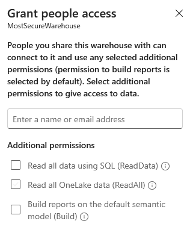

# 1 – Implement security and governance

Security in Fabric is layered: each layer narrows what the previous one grants. The starting point is always the workspace; on top of it you can refine other things.

| Level          | What it controls                                                                                   | Where it is configured                                                                   | Exam objective                                                                 |
| -------------- | -------------------------------------------------------------------------------------------------- | ---------------------------------------------------------------------------------------- | ------------------------------------------------------------------------------ |
| Workspace      | Who can enter the workspace and what they can do on all items (Admin, Member, Contributor, Viewer) | Workspace → Manage access                                                                | Implement workspace-level access controls                                      |
| Item           | Access to a single item without a workspace role (Read, ReadData, ReadAll, Build, …)               | Item Share and Manage permissions                                                        | Implement item-level access controls                                           |
| Data           | Which rows, columns, tables, folders, and files the user sees inside an item                       | Semantic model (RLS/OLS), T-SQL (Warehouse and SQL analytics endpoint), OneLake security | Implement row-level, column-level, object-level, and file-level access control |
| Classification | How content is labeled and protected, including on export                                          | Microsoft Purview Information Protection                                                 | Apply sensitivity labels to items                                              |
| Trust          | Which items are trustworthy or official (does not change permissions)                              | Item settings → Endorsement                                                              | Endorse items                                                                  |

## 1.1 Implement workspace-level access controls

There are four workspace roles, from least to most privileged:

Viewer → Contributor → Member → Admin.

Each role includes everything the previous one can do. Whoever creates the workspace is always its Admin. Roles can be assigned to users or groups.

**Least privilege:** a role applies to all items in the workspace. If someone needs access to only one item, don't give them a role: share the item (see Implement item-level access controls).

**Roles and data security:** Admin, Member, and Contributor have edit permission on items, so they are not restricted by the semantic model's RLS and OLS or by OneLake security roles. To enforce data security on a person, assign them the Viewer role (or no role, sharing only the item).

**Role by role**

  - > **Viewer (read-only):** views the content of pipelines, notebooks, Spark job definitions, ML models, Eventstreams, KQL databases, and dashboards; connects to the SQL analytics endpoint; reads Lakehouse and Warehouse data only with T-SQL (TDS endpoint); can run or cancel pipelines and view the output of pipelines, notebooks, and ML runs. No access to Spark or OneLake APIs.

  - > **Contributor:** everything a Viewer can do, plus create, write, and delete items; read data through Spark, OneLake APIs, and Lakehouse explorer; run or cancel notebooks and Spark jobs; schedule refreshes through the on-premises gateway and modify gateway connection settings. Cannot add people or allow resharing.

  - > **Member:** everything a Contributor can do, plus add people with equal or lower permissions and allow others to reshare items.

  - > **Admin:** everything a Member can do, plus update and delete the workspace and add or remove people, including other admins.

**Permissions matrix**

| Capability                                                        | Viewer | Contributor | Member | Admin |
| ----------------------------------------------------------------- | ------ | ----------- | ------ | ----- |
| View content; read data with T-SQL (SQL endpoint)                 | Yes    | Yes         | Yes    | Yes   |
| Run/cancel pipelines; view run output                             | Yes    | Yes         | Yes    | Yes   |
| Read data through Spark, OneLake APIs, Lakehouse explorer         | –      | Yes         | Yes    | Yes   |
| Create, write, and delete items                                   | –      | Yes         | Yes    | Yes   |
| Run/cancel notebooks and Spark jobs                               | –      | Yes         | Yes    | Yes   |
| Schedule refresh and modify on-premises gateway settings          | –      | Yes         | Yes    | Yes   |
| Add people with lower permissions; allow resharing                | –      | –           | Yes    | Yes   |
| Add/remove people (including admins); update/delete the workspace | –      | –           | –      | Yes   |

**Exam tip:** a Viewer can query a lakehouse only through the SQL analytics endpoint, never with Spark. Someone who must create items but not manage access → Contributor. Someone who must manage access → Member or Admin.

## 1.2 Implement item-level access controls

If you **don't want to give people access to EVERYTHING in a workspace**, you can give people more granular **item-level access**. This is available for nearly all Fabric items, apart from Data Pipelines, and Dataflows

**Item permissions when sharing a warehouse**

| Permission                                                       | What it grants                                                                            | Where it applies     |
| ---------------------------------------------------------------- | ----------------------------------------------------------------------------------------- | -------------------- |
| Read                                                             | Connect to the item and see its metadata. On its own it does not give access to data.     | All items            |
| ReadData (“Read all SQL endpoint data”)                          | Read all data with T-SQL through the SQL analytics endpoint, without a workspace role.    | Lakehouse, Warehouse |
| ReadAll (“Read all Apache Spark data” / “Read all OneLake data”) | Read data in OneLake (files and tables) with Spark, OneLake APIs, and Lakehouse explorer. | Lakehouse, Warehouse |
| Write (Edit)                                                     | Modify the item.                                                                          | Editable items       |
| Reshare                                                          | Share the item with other people.                                                         | All items            |
| Build                                                            | Create new content on the model: reports, Analyze in Excel, export of underlying data.    | Semantic model       |

## 1.3 Implement row-level, column-level, object-level, and file-level access control

These controls restrict **what a user sees inside an item they can already open**. They are implemented in different places depending on the engine: semantic model (Power BI), T-SQL on Warehouse and SQL analytics endpoint, and OneLake security for lakehouse tables, folders, and files. The three systems are independent: defining RLS in the warehouse does not apply it to the semantic model, and vice versa.

**Which tool for which level**

| Level              | Semantic model                                                             | Warehouse / SQL analytics endpoint                                                             | OneLake security (lakehouse)                                             |
| ------------------ | -------------------------------------------------------------------------- | ---------------------------------------------------------------------------------------------- | ------------------------------------------------------------------------ |
| Row-level (RLS)    | Role with a DAX filter on the table                                        | CREATE SECURITY POLICY with a filter predicate (inline table-valued function)                  | Role with a row filter rule (Read permission only)                       |
| Column-level (CLS) | Object-level security on the column (None permission, with Tabular Editor) | GRANT / DENY SELECT on columns                                                                 | Role with excluded columns (Read permission only)                        |
| Object-level (OLS) | Object-level security on a table or column (None permission)               | GRANT / DENY on tables, views, functions, and procedures                                       | Role with access to selected tables or folders                           |
| File-level         | Not applicable                                                             | Not applicable                                                                                 | Role with access to folders and files (Files area)                       |
| Who is subject     | Viewers only: Admin, Member, and Contributor are not restricted            | Viewers and users with a shared item; Admin, Member, and Contributor have elevated permissions | Anyone who is not Admin, Member, or Contributor: the model is Grant-only |

**RLS to a Warehouse table**

Prerequisites: the user must have the ability to read the table before applying RLS, which cann be given through ReadData permissions or Read permmissions plus Granting SELECT OLS on table of interest.

1.  Create a schema for all your security-related things (called Security) - this is optional, but it's good to keep all security-related assets in one schema.

CREATE SCHEMA Security;

2.  Create a **T-SQL Function**, which filters the rows in a given table, based on the logged-in user's USER\_NAME(), returning the filtered table. *Note: it also returns the rows if you are a member of the 'manager' role, for convenience.*

CREATE FUNCTION Security.f\_FilterRowsForLoggedInUser(@SalesRep AS varchar(100))

RETURNS TABLE

WITH SCHEMABINDING

AS

RETURN SELECT 1 AS f\_FilterResult

WHERE @SalesRep = USER\_NAME() OR IS\_ROLEMEMBER('manager') = 1;

GO;

3.  Set up a **SECURITY POLICY to apply the function to the table**

CREATE SECURITY POLICY SalesRowFilterPolicy

ADD FILTER PREDICATE Security.f\_FilterRowsForLoggedInUser(SalesRep)

ON Sales.Orders

WITH (STATE = ON);

**CLS and OLS in Data Warehouse**

Prerequisites is the user must have **Read permission ONLY**. This means:

  - > **They should not be given any Workspace-level role**

  - > **You should share the Warehouse (item-level) with NO ADDITIONAL PERMISSIONS, like the screenshot below:**



**  
**For OLS, use a GRANT statement, like this, to give the user (or role) SELECT permissions on the table:

GRANT SELECT ON Sales.Orders TO \[SalesReps\];

For CLS, use a GRANT statement, like below, to give the user (or role) SELECT permissions on specific columns in a specific table:

GRANT SELECT ON Sales.CustomerDetails

(CustomerId, AccountCreationDate)

TO \[SalesReps\];

**OneLake security: file based access using data roles tables**

OneLake security applies role-based access control directly to data in OneLake. A role grants access (Read or ReadWrite) to tables and folders of an item, for example a lakehouse, and can include row and column rules. The permission applies across all Fabric experiences: Spark, SQL analytics endpoint, Direct Lake, and Lakehouse explorer.

  - > **Role structure:** name, Grant type (only grant exists, not deny), Read or ReadWrite permission, included data (all, or selected tables and folders), and members (Microsoft Entra users and groups).

  - > **Object-level and file-level:** security applies to tables and folders. Delta tables and schemas are folders, so they are secured the same way. Permissions are inherited by subfolders and files: securing a folder in the Files area means controlling access to unstructured files.

**Exam tip:** semantic model RLS and OLS → Viewers only. Dynamic RLS → USERPRINCIPALNAME() plus a mapping table. Hidden columns or tables in the model → OLS with Tabular Editor. RLS and CLS in T-SQL → CREATE SECURITY POLICY and GRANT / DENY on columns. Lakehouse folders and files → OneLake security (Read / ReadWrite roles, Grant-only, DefaultReader role).

## 1.4 Apply sensitivity labels to items

Sensitivity labels are Microsoft Purview Information Protection labels that classify content by sensitivity, for example Public, General, Confidential, Highly Confidential. In Fabric and Power BI they are applied to items and follow the data when it is exported. A label classifies and protects: it does not replace roles, RLS, and other access controls; it complements them.

**Prerequisites and enablement**

  - > **Definition:** labels are created and published in Microsoft Purview, with label policies targeting users or groups. They are not created in Fabric.

  - > **Tenant setting:** the Fabric admin enables “Allow users to apply sensitivity labels for content” (Information protection section), for the whole organization or for specific security groups.

  - > **Who can apply them:** anyone covered by a label policy who has edit permission on the item. One label per item; parent labels (with sublabels) cannot be applied, use the sublabel.

**How to apply them**

  - > **Power BI Desktop:** Home tab → Sensitivity. The label is saved in the .pbix file and stays with the file.

  - > **Fabric and Power BI service:** from the item's settings or header → Sensitivity label. It applies to semantic models, reports, dashboards, dataflows, and Fabric items such as lakehouses and warehouses.

**Inheritance and propagation**

  - > **On creation:** a new report created on a labeled model inherits the model's label, even if the downstream tenant setting is disabled.

  - > **Downstream inheritance:** the tenant setting “Automatically apply sensitivity labels to downstream content” propagates a label change on a model or report to existing items built on it (other models, reports, dashboards). It works in two modes: with user consent (default) or automatic.

  - > **From the data source:** the tenant setting “Apply sensitivity labels from data sources to their data in Power BI” makes the model inherit the label of data labeled in Purview (for example Azure SQL Database or Azure Synapse).

  - > **Export:** labels and protection follow content exported to Excel, PowerPoint, and PDF, within the limits of the export settings, and the .pbix. Other export and sharing methods do not apply labels and protection.

**Exam tip:** labels are defined in Microsoft Purview and enabled with the tenant setting. A new report always inherits the model's label; propagation to existing items requires the downstream setting. Exported Excel, PowerPoint, and PDF files keep the label and protection.

## 1.5 Endorse items

Endorsement highlights trustworthy items and marks official ones. It neither grants nor removes permissions: it signals trust, not access.

| Type        | Meaning                                                                            | Who can apply it                                                                     | Items                                                                |
| ----------- | ---------------------------------------------------------------------------------- | ------------------------------------------------------------------------------------ | -------------------------------------------------------------------- |
| Promoted    | Content considered valuable and useful, to encourage reuse                         | The item owner or anyone with Write permission on the item                           | All Fabric and Power BI items except dashboards                      |
| Certified   | Content that meets the organization's quality standards, reliable and ready to use | Only reviewers authorized by the Fabric admin (security groups)                      | All Fabric and Power BI items except dashboards                      |
| Master data | Core data, single source of truth (for example customer list or product codes)     | Only reviewers authorized by the Fabric admin (“Endorse master data” tenant setting) | Only items that contain data, such as lakehouses and semantic models |

  - > **How to apply:** from the item settings (⋯ → Settings → Endorsement) choose the type. Whoever is not authorized to certify or mark as master data must follow the organization's process to request it.

**Exam tip:** “signal that a model is trustworthy across the organization” → Certified, which only reviewers authorized by the Fabric admin can apply. “The owner wants to recommend their item” → Promoted. “Core data, single source of truth” → Master data, only on items with data.

## 1.6 T-SQL permissions: GRANT, DENY and REVOKE

Warehouse and SQL analytics endpoint security is managed with standard T-SQL permission statements. Permissions can be given on a **database**, a **schema**, or a single **object** (table, view, procedure, function).

```sql
GRANT SELECT ON SCHEMA::sales TO [user1@contoso.com];
GRANT ALTER ON SCHEMA::schemaA TO [user1@contoso.com];
DENY  SELECT ON OBJECT::sales.Customers(Email) TO [user1@contoso.com];   -- column-level
REVOKE SELECT ON SCHEMA::sales FROM [user1@contoso.com];
```

**Which permission for which action**

| Goal | Permission | Notes |
| --- | --- | --- |
| Read data | `SELECT` | Can be granted on a schema, a table, a view, or specific columns. |
| Insert, update, delete rows | `INSERT`, `UPDATE`, `DELETE` | Warehouse only (the lakehouse SQL endpoint is read-only). |
| Run a stored procedure or function | `EXECUTE` | |
| Truncate a table | `ALTER` on the table | `TRUNCATE TABLE` requires ALTER on the table. Granting `ALTER ON SCHEMA::schemaA` limits it to the objects in schemaA only. |
| Create or change objects | `CREATE TABLE`, `ALTER` | `CREATE TABLE` is granted at database level, plus `ALTER` on the target schema. |

**Scope rules**

  - `SCHEMA::name` covers every current and future object in that schema; `OBJECT::schema.name` covers one object; `DATABASE::name` covers everything.
  - **DENY always wins** over GRANT.
  - Least privilege: grant at the narrowest scope that satisfies the requirement (usually the schema).
  - Workspace roles Admin, Member and Contributor bypass these T-SQL permissions, so the restricted user must be a Viewer or only have the item shared.

**Exam tip:** "truncate tables in one schema only" → `GRANT ALTER ON SCHEMA::schemaA TO User1`.

## 1.7 Testing row-level security

RLS in a semantic model is defined with **roles** and DAX filter expressions. A **dynamic** role uses `USERPRINCIPALNAME()` to filter rows by the signed-in user (for example, an employee table matched with the user's email).

```dax
[Email] = USERPRINCIPALNAME()
```

**How to test**

  - **Power BI Desktop:** Modeling > View as, then pick one or more roles (and optionally *Other user*).
  - **Power BI service:** semantic model > Security > the three dots next to a role > **Test as role**. For a *dynamic* role you also have to impersonate a **specific user**, because the filter depends on who is signed in. Testing the role alone does not show what that person sees.
  - Members of the workspace with edit rights (Admin, Member, Contributor) are not filtered by RLS, so they cannot validate it by simply opening the report. Share with a Viewer instead.

**Exam tip:** dynamic RLS → "Test as role" combined with impersonating the specific user (the HR manager), not just the role.

## 1.8 Row-level security in a warehouse and the user functions of DAX

**T-SQL RLS (Warehouse and SQL analytics endpoint)** uses two objects:

  1. An **inline table-valued function** (the predicate) that returns a row when the user may see the data.
  2. A **security policy** that adds the function as a FILTER (or BLOCK) predicate on the table.

```sql
CREATE FUNCTION Security.fn_customer_filter(@SalesRep AS varchar(100))
RETURNS TABLE WITH SCHEMABINDING AS
RETURN SELECT 1 AS ok WHERE @SalesRep = USER_NAME();
GO
CREATE SECURITY POLICY Security.CustomerPolicy
ADD FILTER PREDICATE Security.fn_customer_filter(SalesRep) ON dbo.Table1
WITH (STATE = ON);
```

A database role, stored procedure or constraint is **not** part of the RLS pair (roles may be used to grant access, but the objects that implement RLS are the function and the security policy).

**DAX functions for dynamic RLS in a semantic model**

| Function | Returns |
| --- | --- |
| `USERPRINCIPALNAME()` | The user principal name (UPN, like user@contoso.com) of the signed-in user. Use it for dynamic RLS in the Fabric/Power BI service. |
| `USERNAME()` | Domain\user in Desktop and UPN in the service, but it can be blank in some contexts. Prefer `USERPRINCIPALNAME()`. |
| `USEROBJECTID()` | The Microsoft Entra object ID (a GUID), not the UPN. |

Creating a role does not change what a measure returns; if `USERNAME()` returns blank and you need the UPN, switch the measure to `USERPRINCIPALNAME()`.

## 1.9 Warehouse sharing: default permissions

When you **share** a warehouse (or SQL analytics endpoint) with a user and keep only the **default permissions**, the user gets **Read**:

  - They can **connect to the SQL analytics endpoint (TDS)** of the warehouse.
  - They **cannot** read table data (that needs `ReadData`, "Read all SQL endpoint data", or T-SQL `GRANT SELECT`).
  - They cannot read the underlying Parquet files in OneLake (that needs `ReadAll`) and cannot build reports on the default semantic model (that needs `Build`).

| Extra permission when sharing | Adds |
| --- | --- |
| ReadData | Read all data through the SQL endpoint (T-SQL). |
| ReadAll | Read the files and tables in OneLake (Spark, OneLake explorer). |
| Build | Create reports/semantic models on the default semantic model. |
| Reshare | Share the item with others. |

## 1.10 Exam quick reference

  - > Workspace roles → Viewer is read-only (T-SQL only, no Spark), Contributor creates and writes and reads with Spark, Member adds people, Admin manages the workspace.

  - > Access to a single item without a workspace role → share the item (Read, ReadData, ReadAll, Build).

  - > Semantic model RLS and OLS → apply only to Viewers; Admin, Member, and Contributor bypass them.

  - > Dynamic RLS → USERPRINCIPALNAME() plus a mapping table; users are assigned to roles in the service, not in Desktop.

  - > Hide tables or columns in a model → OLS with Tabular Editor (None permission).

  - > RLS and CLS in T-SQL → CREATE SECURITY POLICY with a filter predicate and GRANT / DENY SELECT on columns; mask a value → dynamic data masking.

  - > Folders, files, and tables of a lakehouse → OneLake security (Read or ReadWrite roles, Grant-only, DefaultReader role to be managed).

  - > Sensitivity labels → defined in Microsoft Purview, enabled by the tenant setting; inherited when a report is created; they follow export to Excel, PowerPoint, and PDF.

  - > Endorsement → Promoted (owner or anyone with Write), Certified and Master data (only reviewers authorized by the Fabric admin); Master data only on items with data; dashboards cannot be promoted or certified.
