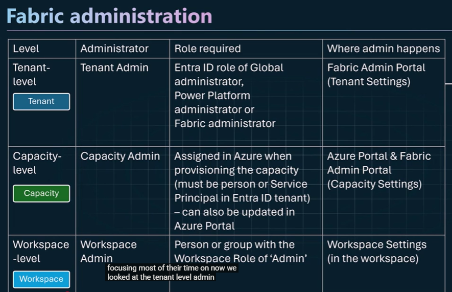
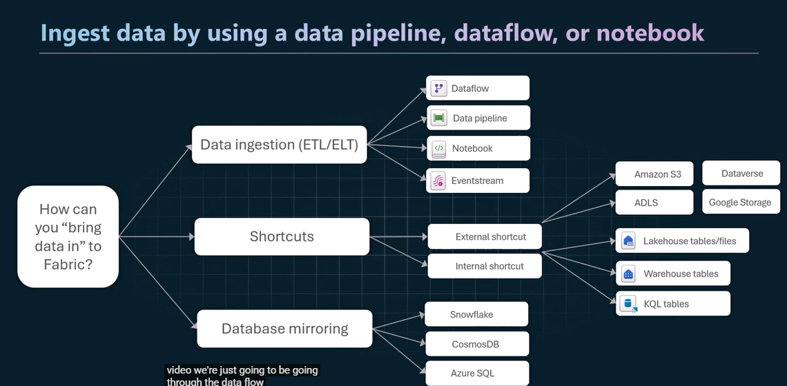
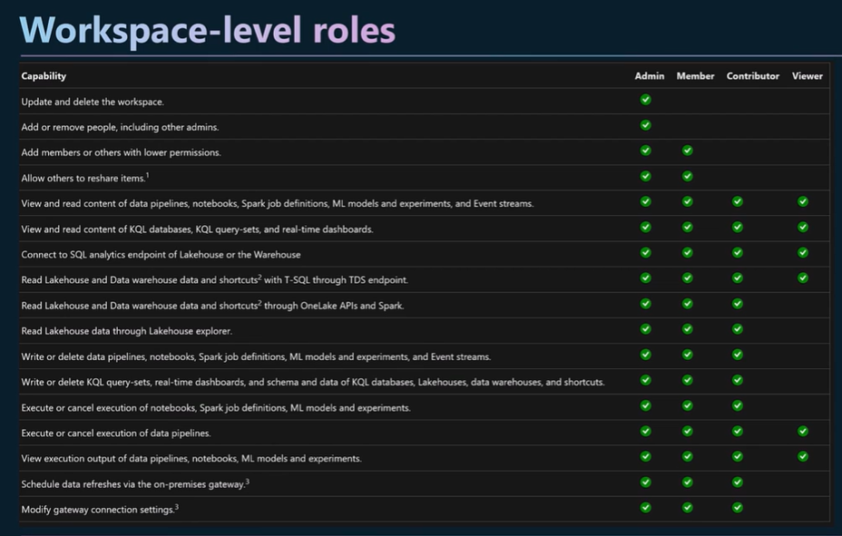
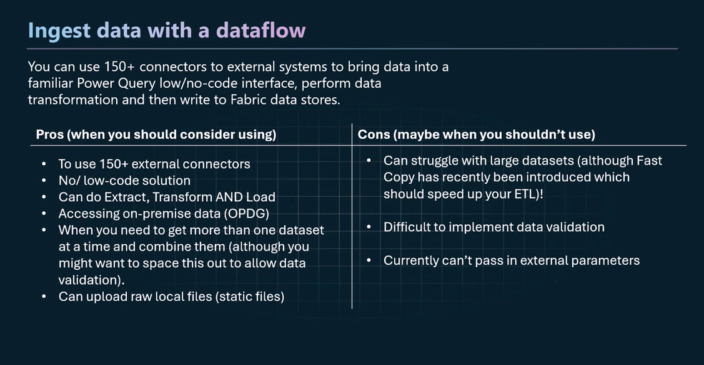
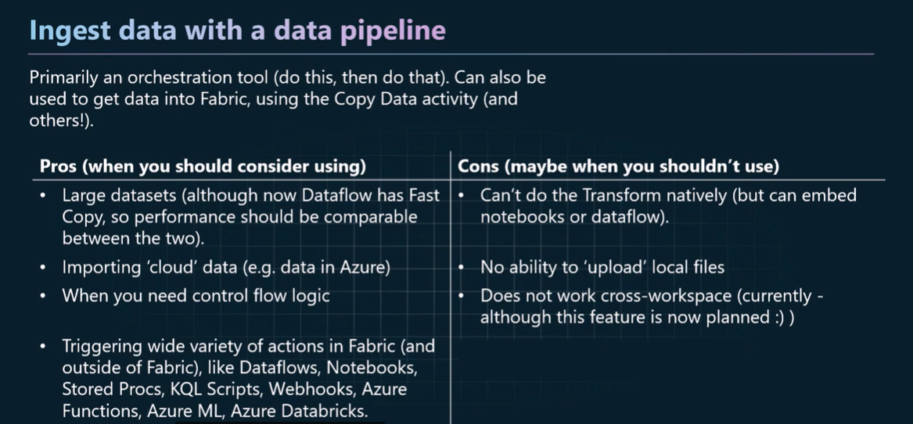
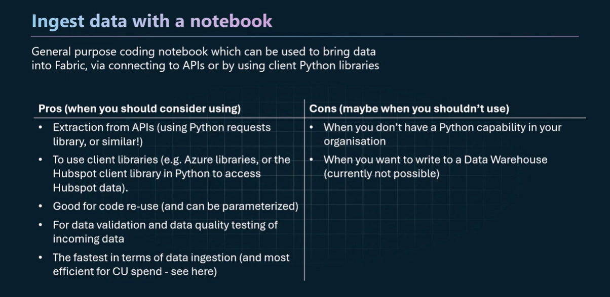

# 15 – Appendix: Original Course Slides

## 15.1 Fabric administration levels

## 15.2 Ways to bring data into Fabric

## 15.3 Workspace-level roles

## 15.4 Ingest data with a dataflow

## 15.5 Ingest data with a data pipeline

## 15.6 Ingest data with a notebook

